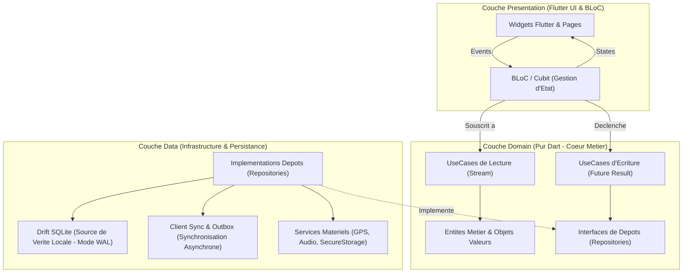
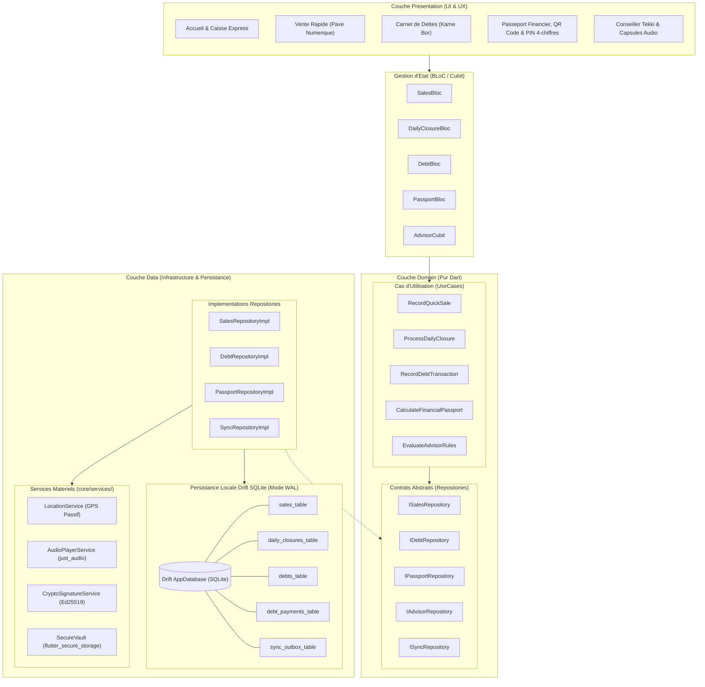
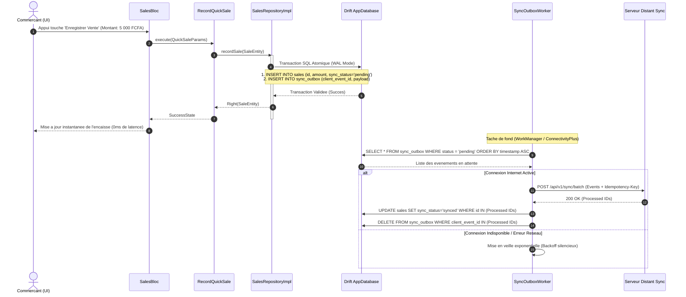
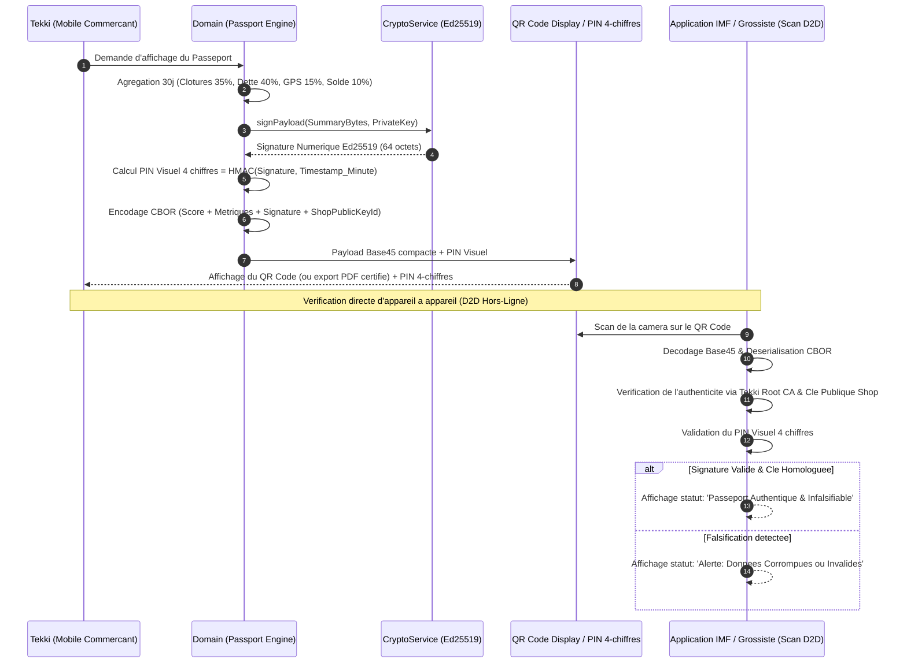
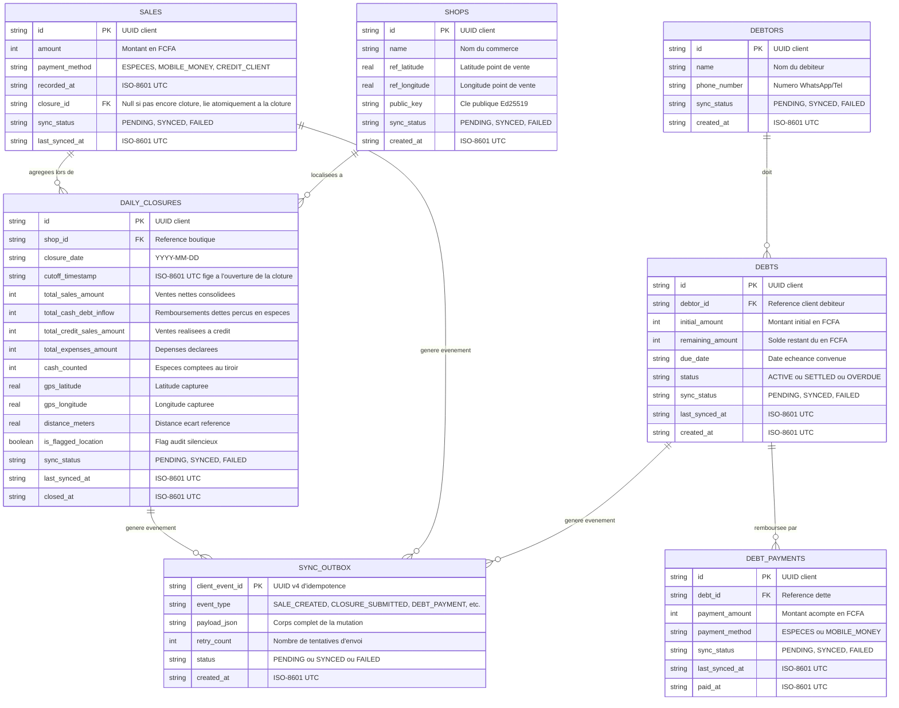

# Architecture Spine — Tekki

## Design Paradigm

L'application mobile **Tekki** adopte une **Clean Architecture** (Ports & Adapters / Oignon) unifiée à un modèle réactif **Offline-First Reactive Outbox**. L'intégralité du produit s'exécute de façon autonome et non-bloquante sur le terminal Android du commerçant. La base de données locale Drift (SQLite) constitue l'unique source de vérité (**Single Source of Truth**), assurant une latence nulle d'affichage et une résilience totale aux coupures réseau.



### Application Stricte des Principes SOLID & Séparation CQRS Locale

1. **S — Single Responsibility Principle (SRP) :** Les cas d'utilisation sont strictement découplés entre lecture et écriture :
   - **Query UseCases :** Exposent des `Stream<T>` continus connectés aux tables Drift (ex. `WatchTodayCashSummary`, `WatchActiveDebts`).
   - **Command UseCases :** Exécutent une mutation atomique et retournent un `Future<Result<Unit, Failure>>` (ex. `RecordQuickSale`, `CloseDailyCash`, `SettleDebtPayment`).
   Les BLoCs s'abonnent aux flux de requêtes via `emit.forEach` et délèguent les mutations aux commandes, éliminant toute double émission d'état.
2. **O — Open/Closed Principle (OCP) :** Le moteur de scoring du Passeport Financier (`PassportScoringPolicy`) et les stratégies d'exportation (`PassportExportStrategy`) sont fermés aux modifications mais ouverts aux extensions pour intégrer de nouvelles métriques institutionnelles sans altérer les règles existantes.
3. **L — Liskov Substitution Principle (LSP) :** Tous les accès aux capteurs et à la persistance sont abstraits. Les implémentations concrètes (`DriftAppDatabase`, `GeolocatorServiceImpl`, `SecureStorageServiceImpl`) peuvent être interchangées avec des fakes en mémoire sans altérer les tests unitaires du Domain.
4. **I — Interface Segregation Principle (ISP) :** Ségrégation des interfaces : dépôts de lecture épurés (`ISalesReader`, `IDebtReader`), dépôts d'écriture ciblés (`ISalesWriter`, `IDebtWriter`) et services périphériques spécialisés (`ILocationService`, `IAudioPlaybackService`, `ISecureKeyStorage`).
5. **D — Dependency Inversion Principle (DIP) :** La couche `Domain` est rédigée en **pur Dart** (SDK Dart uniquement, zéro import `package:flutter/*` ou `package:drift/*`). Les couches externes (`data` et `presentation`) dépendent exclusivement des abstractions du `domain`. L'injection de dépendances est gérée de manière déclarative via `get_it` et `injectable`.

---

## Invariants & Rules

### AD-1 — Clean Architecture en 3 Couches & Règle de Dépendance Unidirectionnelle [ADOPTED]

- **Binds:** `all`
- **Prevents:** Le couplage direct entre les composants graphiques Flutter et la base SQLite/Drift, la dispersion de règles métier dans les widgets ou les requêtes SQL, et l'impossibilité de tester le cœur fonctionnel en environnement Dart pur sans émulateur.
- **Rule:** Le code source est obligatoirement partitionné en 3 couches concentriques strictes : `domain`, `data`, `presentation`. La couche `domain` ne doit importer aucun package Flutter (`package:flutter/*`), aucun ORM (`package:drift/*`), ni aucun composant réseau. Les dépendances de code traversent exclusivement les frontières de l'extérieur vers l'intérieur : `presentation -> domain <- data`. L'accès aux entités se fait par instanciation de DTOs dans `data` mappés vers des entités immutables dans `domain`.

### AD-2 — Modèle Réactif Offline-First & Base Locale comme Unique Source de Vérité [ADOPTED]

- **Binds:** `CAP-SALES-HYBRID`, `CAP-KARNE-BOR`, `CAP-FINANCIAL-PASSPORT`, `CAP-OFFLINE-SYNC`
- **Prevents:** Les blocages d'interface utilisateur en cas de connectivité dégradée (zones 2G/Edge ou coupures réseau), les divergences d'état entre l'UI et la mémoire, et les échecs de saisie de vente ou de clôture au comptoir.
- **Rule:** 100 % des opérations de lecture et d'écriture s'effectuent immédiatement sur la base de données locale Drift (SQLite). L'interface utilisateur observe exclusivement des flux réactifs locaux (`Stream` exposés par Drift au travers des cas d'utilisation de lecture et consommés par les BLoCs via `emit.forEach`). Aucune interaction utilisateur ne doit attendre un retour serveur ou bloquer sur un appel réseau.

### AD-3 — File d'Attente Locale Outbox & Idempotence des Synchronisations [ADOPTED]

- **Binds:** `CAP-OFFLINE-SYNC`
- **Prevents:** La perte de données en cas de panne ou déconnexion prolongée, la duplication de transactions lors des tentatives de synchronisation répétées, et les conflits d'écritures concurrentes client-serveur.
- **Rule:** Toute mutation de données métier (création de vente, ajout ou remboursement de dette, validation de clôture) doit enregistrer dans la même transaction atomique locale SQLite l'entité concernée et une entrée dans la table `sync_outbox`. Chaque entrée d'outbox contient un identifiant unique universel UUID v4 généré côté client (`client_event_id`), le type d'événement, la charge utile JSON et un horodatage ISO-8601 UTC. Le worker de synchronisation en tâche de fond traite les événements selon l'ordre chronologique d'insertion et transmet le `client_event_id` comme clé d'idempotence stricte.

### AD-4 — Passeport Financier Autonome, Signature Cryptographique Ed25519 & QR Compact CBOR [ADOPTED]

- **Binds:** `CAP-FINANCIAL-PASSPORT`
- **Prevents:** La falsification des scores et attestations par altération manuelle de la base SQLite locale, l'impossibilité de vérifier le passeport en zone blanche chez un partenaire financier, et l'exigence d'un portail web hébergé en ligne.
- **Rule:** Le score de réputation et le Passeport Financier sont calculés intégralement in-app par le cas d'utilisation `CalculateFinancialPassport`. La charge utile du passeport est sérialisée au format binaire compact CBOR, puis signée cryptographiquement avec l'algorithme asymétrique Ed25519 via le package `cryptography`. La charge utile compacte signée est encodée en Base45 pour générer un QR Code autonome (scannable d'appareil à appareil en moins d'une seconde par un agent de crédit sans accès réseau) et intégrée dans l'attestation PDF certifiée.

### AD-5 — Enregistrement Hybride des Ventes & Réconciliation Clôture Express [ADOPTED]

- **Binds:** `CAP-SALES-HYBRID`
- **Prevents:** L'écrasement ou la double comptabilisation des ventes unitaires au fil de l'eau lors de la validation de la clôture express consolidée du soir.
- **Rule:** Les ventes unitaires rapides saisies au fil de l'eau sont persistées en tant qu'enregistrements individuels `Sale` horodatés. Lors de l'ouverture de l'écran de clôture express du soir, l'application agrège dynamiquement la somme des ventes unitaires du jour pour pré-remplir le champ de déclaration. La validation de la clôture crée une entité `DailyClosure` scellant la période (chiffre d'affaires consolidé, dépenses de réassort, encaisse déclarée) sans écraser ni dupliquer les micro-ventes sous-jacentes dans le grand livre local.

### AD-6 — Ancrage Géographique Passif Non-Bloquant & Flag Silencieux d'Intégrité [ADOPTED]

- **Binds:** `CAP-GPS-ANCHOR`
- **Prevents:** La fraude sur la régularité des clôtures par des déclarations fictives hors du point de vente, tout en évitant de bloquer ou frustrer le commerçant en cas de signal GPS instable ou désactivé.
- **Rule:** Lors de la validation de la clôture journalière, l'application lance une capture passive de la position géographique avec un délai de temporisation (timeout) strict de 5 secondes. Si les coordonnées obtenues se situent au-delà d'un rayon de cohérence de 200 mètres par rapport à l'emplacement de référence de la boutique enregistré lors de l'onboarding, ou si la géolocalisation est indisponible, l'entité `DailyClosure` enregistre silencieusement `is_flagged_location: true` ainsi que la distance calculée. Aucun message d'erreur ni blocage d'interface n'est opposé à l'utilisateur.

### AD-7 — Moteur Déterministe du Conseiller Tekki & Cache Audio Local [ADOPTED]

- **Binds:** `CAP-ADVISOR`
- **Prevents:** Les coûts d'inférence en ligne, la dépendance à un modèle LLM distant, la latence au runtime, la surconsommation de forfait data mobile et l'incompréhension des recommandations textuelles par des commerçants à faible niveau de littératie.
- **Rule:** Le Conseiller Tekki est implémenté sous la forme d'un moteur de règles déterministe autonome au sein de la couche `domain`. Il évalue les 4 métriques de santé financière (régularité de caisse, vélocité de recouvrement du Karné Bor, constance d'encaisse, ancrage GPS) et sélectionne les règles d'audit (feux tricolores) associées à des capsules audio éducatives pré-enregistrées et scénarisées (30 à 45 secondes) en Wolof et Français. Pour respecter l'empreinte de 15 Mo, les capsules sont compressées en Opus mono @ 32 kbps (~160 Ko par capsule) ; seule la capsule d'accueil est embarquée dans les assets de l'APK, les suivantes sont téléchargées et mises en cache localement par le moteur de synchronisation.

### AD-8 — Gestion d'État Unidirectionnelle par BLoC & Séparation UI/Métier [ADOPTED]

- **Binds:** `all`
- **Prevents:** La prolifération de logique métier au sein du Widget Tree Flutter, les reconstructions inutiles d'écrans (`rebuilds` coûteux en batterie et CPU sur terminaux d'entrée de gamme), et les fuites de mémoire.
- **Rule:** Tout composant dynamique de l'interface utilisateur est raccordé à un `Bloc` ou `Cubit` (`flutter_bloc`). Les événements descendent depuis les widgets vers le BLoC (`add(Event)`), et les états immuables remontent vers l'UI (`emit(State)`). Les BLoCs communiquent exclusivement avec la couche `domain` en appelant des cas d'utilisation dédiés. Les widgets Flutter ont pour interdiction absolue d'effectuer des calculs d'agrégation, des appels de persistance ou des requêtes Drift directes.

### AD-9 — Intégration Caisse-Dettes & Réconciliation des Mouvements d'Espèces [ADOPTED]

- **Binds:** `CAP-SALES-HYBRID`, `CAP-KARNE-BOR`
- **Prevents:** La rupture de concordance de caisse entre les encaissements réels et les ventes déclarées, les disparités inexpliquées lors du comptage physique des espèces, et l'absence de traçabilité des ventes à crédit.
- **Rule:** L'encaisse théorique du soir est rigoureusement calculée selon la formule mathématique : `Encaisse_Theorique = Ventes_Comptant_Especes + Remboursements_Dettes_Especes - Depenses_Especes`. Tout remboursement de dette (`debt_payments`) réglé en espèces incrémente immédiatement le journal de caisse sous l'indicateur `debt_cash_inflow`. Les ventes consenties à crédit sont marquées du mode de paiement `CREDIT_CLIENT`, créent une dette dans le Karné Bor, et sont exclues de l'encaisse physique attendue.

### AD-10 — Snapshotting Atomique et Scellement Temporel de la Clôture Journalière [ADOPTED]

- **Binds:** `CAP-SALES-HYBRID`
- **Prevents:** Les conditions de course où une vente rapide enregistrée pendant le comptage manuel de la caisse provoque un décalage mathématique permanent entre la somme des ventes et le montant scellé par la clôture.
- **Rule:** Dès l'ouverture du formulaire de clôture express, un instantané est figé à un horodatage précis (`cutoff_timestamp = DateTime.now().toUtc()`). Lors de la validation, une transaction SQL unique et atomique : (1) met à jour toutes les ventes orphelines créées avant ce `cutoff_timestamp` en leur assignant le `closure_id` généré (`UPDATE sales SET closure_id = ? WHERE closure_id IS NULL AND recorded_at <= ?`), et (2) enregistre la ligne `DailyClosure`. Toute vente enregistrée après cet instantané demeure orpheline et bascule automatiquement sur la journée comptable suivante.

### AD-11 — Chaîne de Confiance PKI et Code de Confirmation Visuel pour Vérification D2D [ADOPTED]

- **Binds:** `CAP-FINANCIAL-PASSPORT`
- **Prevents:** La falsification malveillante de scores par modification de la base SQLite et auto-signature par une fausse clé locale non homologuée.
- **Rule:** La signature Ed25519 in-app est validée par une ancre de confiance PKI : lors de l'activation initiale de l'application, la clé publique du commerçant est enregistrée ou signée numériquement par le certificat racine de l'autorité Tekki (Tekki Root CA). L'application vérificatrice des agents de crédit embarque cette clé publique racine pour authentifier l'émetteur. De surcroît, le domaine calcule un **code PIN visuel à 4 chiffres** dérivé du hachage de la signature et de la minute courante (`HMAC-SHA256(Signature, Timestamp_Minute)` tronqué), affiché en clair sur l'écran du commerçant et validé de visu par l'agent de crédit pour empêcher les attaques par rejeu de captures d'écran.

### AD-12 — Traçabilité Locale de Synchronisation & Garde-fous Anti-OOM Android Go [ADOPTED]

- **Binds:** `all`, `CAP-OFFLINE-SYNC`
- **Prevents:** L'amnésie d'état de synchronisation après suppression de l'outbox, l'incapacité de l'UI à signaler les anomalies de synchro, et les plantages par saturation mémoire (OOM) sur smartphones 1 Go RAM (Android Go).
- **Rule:** Toutes les tables d'entités mutables (`sales`, `daily_closures`, `debts`, `debt_payments`) intègrent obligatoirement les colonnes `sync_status` (`PENDING`, `SYNCED`, `FAILED`) et `last_synced_at`. Lorsque l'outbox confirme le traitement distant d'un événement, le statut de l'entité locale est mis à jour à `SYNCED` avant suppression de la ligne d'outbox. Pour prévenir tout épuisement de mémoire vive sur profil Android Go :
  1. La base Drift SQLite active impérativement le mode journalier WAL (`PRAGMA journal_mode = WAL;`) et le mode synchrone normal (`PRAGMA synchronous = NORMAL;`).
  2. Toutes les requêtes `Stream` de l'UI sont strictement bornées et paginées (`limit(50)`).
  3. Des index SQLite sont déclarés sur `closure_id`, `status`, `debtor_id` et `sync_status`.
  4. La génération d'APK en production utilise obligatoirement `flutter build apk --split-per-abi` pour garantir un binaire final de 8.5 à 11 Mo par architecture CPU.

---

## Consistency Conventions

| Concern | Convention |
| :--- | :--- |
| **Nommage des Fichiers** | `snake_case.dart` pour tous les fichiers Dart. Suffixes explicites : `_page.dart`, `_widget.dart`, `_bloc.dart`, `_event.dart`, `_state.dart`, `_usecase.dart`, `_repository.dart`, `_model.dart`, `_entity.dart`. |
| **Nommage des Classes** | `PascalCase` pour classes, mixins et enums. Préfixes explicites et suffixes structurels conformes (ex. `SalesBloc`, `RecordQuickSaleUseCase`, `DailyClosureEntity`, `DriftAppDatabase`). |
| **Identifiants Uniques** | UUID v4 (`String` standard RFC 4122) généré côté client dès l'instanciation de toute entité pour garantir la création offline sans collision. |
| **Monnaies & Montants** | Entiers stricts en FCFA (XOF) sans décimales (`int` en Dart, `INTEGER` en SQLite) pour éliminer les erreurs d'arrondi en virgule flottante. |
| **Dates & Horodatages** | Format ISO 8601 UTC en stockage persistant (`DateTime.toUtc().toIso8601String()`). Conversion en heure locale uniquement lors du rendu dans les widgets UI. |
| **Gestion des Erreurs** | Approche fonctionnelle sans exception non gérée : typage de retour via types scellés Dart 3 `Result<T, Failure>` (succès typé `Success<T>` ou échec typé `Failure`). |
| **Traçabilité Synchro** | Enum standardisé `SyncStatus` (`pending`, `synced`, `failed`) et horodatage `last_synced_at` sur chaque entité persistée. |
| **Modèle d'Immutabilité** | Toutes les entités du Domain et états BLoC sont strictement immutables avec support de copie (`copyWith`), constructeurs constants `const` et égalité par valeur. |

---

## Stack

| Name | Version |
| :--- | :--- |
| Flutter SDK | 3.27.4 |
| Dart SDK | 3.6.2 |
| flutter_bloc | 9.1.1 |
| drift | 2.24.2 |
| drift_flutter | 0.3.1 |
| get_it | 8.0.3 |
| injectable | 2.5.0 |
| cryptography | 2.7.0 |
| cryptography_flutter | 2.7.0 |
| cbor | 6.3.0 |
| dart_base45 | 1.0.0 |
| qr_flutter | 4.1.0 |
| just_audio | 0.9.44 |
| geolocator | 13.0.2 |
| pdf | 3.11.2 |
| share_plus | 10.1.4 |
| flutter_secure_storage | 9.2.4 |
| connectivity_plus | 6.1.1 |
| uuid | 4.5.1 |
| workmanager | 0.10.10 |
| path_provider | 2.1.5 |
| http | 1.6.0 |
| url_launcher | 6.3.1 |
| intl | 0.19.0 |
| build_runner | 2.4.14 |
| drift_dev | 2.24.2 |
| injectable_generator | 2.6.2 |

---

## Structural Seed

### 1. Architecture Globale & Découpage en Packages / Modules



### 2. Modèle Réactif Offline-First & Mécanisme Outbox



### 3. Signature Cryptographique & Vérification D2D du QR Code



### 4. Diagramme Entités / Tables Drift (ERD Local)



### 5. Arborescence du Code Source (`lib/`)

```text
lib/
  core/
    constants/              # Couleurs tokens UX, URLs API, constantes metier
    crypto/                 # Wrapper Ed25519, encodeur CBOR/Base45, keystore & PIN 4-chiffres
    database/               # Initialisation Drift AppDatabase (mode WAL, index), tables & migrations
    errors/                 # Definitions des Failures et Exceptions fonctionnelles
    network/                # ConnectivityObserver, HTTP client avec timeout et intercepteurs
    services/               # Services systemes materiels (LocationService, AudioService, SecureStorage)
    theme/                  # Tokens visuels issus de DESIGN.md (blush #FEECEA, primary #133E59)
    utils/                  # Formateurs monnaie FCFA, date ISO-8601, logger leger
  features/
    sales_and_cash/
      domain/
        entities/           # SaleEntity, DailyClosureEntity
        repositories/       # ISalesReaderRepository, ISalesWriterRepository, IClosureRepository
        usecases/           # RecordQuickSaleUseCase, ProcessDailyClosureUseCase, WatchTodaySalesUseCase
      data/
        datasources/        # SalesLocalDataSource (Drift DAO)
        models/             # SaleModel, DailyClosureModel, Tables Drift
        repositories/       # SalesRepositoryImpl, ClosureRepositoryImpl
      presentation/
        bloc/               # SalesBloc, DailyClosureBloc
        pages/              # HomePage, QuickSaleModal, ExpressClosurePage
        widgets/            # CashCardWidget, GiantKeypadWidget, StreakBannerWidget
    karne_bor/
      domain/
        entities/           # DebtorEntity, DebtEntity, PaymentEntity
        repositories/       # IDebtReaderRepository, IDebtWriterRepository
        usecases/           # CreateDebtUseCase, RecordPaymentUseCase, WatchDebtsUseCase
      data/
        datasources/        # DebtsLocalDataSource (Drift DAO), WhatsAppLauncher
        models/             # DebtorModel, DebtModel, Tables Drift
        repositories/       # DebtRepositoryImpl
      presentation/
        bloc/               # DebtBloc, DebtReminderCubit
        pages/              # KarneBorPage, AddDebtPage, DebtDetailsPage
        widgets/            # DebtCardWidget, OverdueBadgeWidget, WhatsAppReminderButton
    financial_passport/
      domain/
        entities/           # FinancialPassportEntity, ScoreBreakdownEntity
        repositories/       # IPassportRepository
        usecases/           # CalculateFinancialPassportUseCase, GenerateSignedQrUseCase
      data/
        datasources/        # PassportLocalDataSource, PdfGeneratorService
        models/             # PassportModel, CborPassportPayload
        repositories/       # PassportRepositoryImpl
      presentation/
        bloc/               # PassportBloc
        pages/              # PassportOverviewPage, QrFullscreenModal, PdfShareDialog
        widgets/            # PassportQrCardWidget, ScoreBreakdownCard, ExportPdfButton
    advisor/
      domain/
        entities/           # FinancialAdviceEntity, ManagementMetricEntity
        repositories/       # IAdvisorRepository
        usecases/           # EvaluateFinancialHealthUseCase, GetWeeklyAudioCapsuleUseCase
      data/
        datasources/        # AudioAssetDataSource, RulesLocalDataSource
        models/             # AudioCapsuleModel
        repositories/       # AdvisorRepositoryImpl
      presentation/
        bloc/               # AdvisorCubit
        pages/              # AdvisorTabContent
        widgets/            # AudioWavePlayerWidget, TrafficLightIndicatorWidget
    sync/
      domain/
        repositories/       # ISyncRepository
        usecases/           # ProcessOutboxQueueUseCase, WatchSyncStatusUseCase
      data/
        datasources/        # OutboxLocalDataSource, RemoteSyncApiClient, WorkManagerDispatcher
        models/             # OutboxEventModel, Table Drift sync_outbox
        repositories/       # SyncRepositoryImpl
  app.dart                  # MaterialApp.router, injection Theme & Blocs globaux
  injection_container.dart  # Configuration get_it et injectable (Service Locator)
  main.dart                 # Point d'entree applicatif (init async Drift WAL & RunApp)
```

### 6. Déploiement et Enveloppe Opérationnelle

- **Environnement d'Exécution Cible :** Android 8.0+ (API 26+) avec optimisation spécifique pour les appareils à mémoire contrainte (profil Android Go : 1 Go à 2 Go de RAM).
- **Taille de l'Exécutable (APK) :** Plafonnée à 15 Mo grâce à l'arbre de secouage Dart (tree-shaking), à la compression vectorielle des icônes SVG, au packaging exclusif de la première capsule audio (Opus @ 32 kbps), et au déploiement en binaire scindé par architecture (`flutter build apk --split-per-abi`, produisant des APKs de 8.5 à 11 Mo).
- **Cycle de Vie & Résilience :** Le worker de synchronisation utilise `workmanager` pour planifier la vidange de l'outbox dès que `connectivity_plus` signale une connectivité réseau stable et que le terminal dispose d'au moins 15 % de batterie.
- **Protection des Clés :** Les clés cryptographiques stockées via `flutter_secure_storage` sont exclues de la sauvegarde automatique Google Drive via `android:fullBackupContent="@xml/backup_rules"` pour prévenir les corruptions de clés Keystore lors de restaurations d'appareils.

---

## Capability → Architecture Map

| Capability / Area | Lives in | Governed by |
| :--- | :--- | :--- |
| **Enregistrement Ventes & Clôture Express** | `features/sales_and_cash/` | AD-1, AD-2, AD-5, AD-8, AD-9, AD-10 |
| **Carnet de Dettes Numérique (Karné Bor)** | `features/karne_bor/` | AD-1, AD-2, AD-3, AD-8, AD-9 |
| **Passeport Financier & QR Code Signé** | `features/financial_passport/` | AD-1, AD-4, AD-8, AD-11 |
| **Conseiller Tekki (Éducation & Audio)** | `features/advisor/` | AD-1, AD-7, AD-8 |
| **Ancrage Géographique Anti-Fraude** | `core/services/` et `features/sales_and_cash/` | AD-6 |
| **Persistance Locale & Sync Outbox** | `features/sync/` et `core/database/` | AD-2, AD-3, AD-12 |

---

## Deferred

1. **Choix du Fournisseur Cloud Backend :** Le choix de l'infrastructure d'hébergement distant (GCP Cloud Run, AWS ECS ou serveur VPS auto-hébergé avec base Postgres) est différé car le MVP s'exécute à 100 % en local et la synchronisation repose sur un contrat d'API REST asynchrone universel.
2. **Synchronisation Multi-Terminaux par Boutique :** La gestion de sessions multiples concurrentes pour plusieurs vendeurs opérant dans une même boutique est différée post-MVP. Le MVP est unitaire (un terminal Android par gérant de point de vente).
3. **Moteur Vocal Bidirectionnel Temps Réel (STT / LLM / TTS) :** L'intégration d'un agent conversationnel vocal interactif en direct est différée à la roadmap 24-36 mois. Le MVP emploie des capsules audio scénarisées préenregistrées pour éliminer les coûts serveurs et la latence.
4. **Intégrations Directes par API avec les Opérateurs Mobile Money :** La connexion directe aux APIs Wave et Orange Money pour la conciliation automatique est différée pour contourner les délais d'agréments réglementaires. Les soldes sont déclarés manuellement en clôture.
